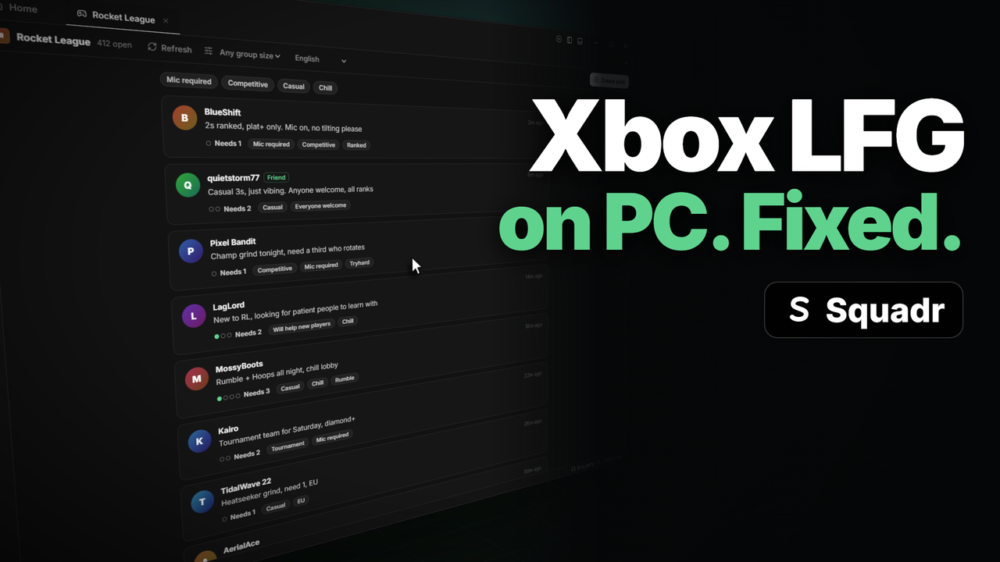

<p align="center"></p>

<h1 align="center">Squadr</h1>
<p align="center"><b>Real Xbox Looking for Group, right on your PC.</b></p>

<p align="center"><a href="../../releases/latest"><b>⬇ Download for Windows</b></a></p>



Searching Xbox LFG on PC and getting "No groups found"? The posts are there. Console players make them all day.
Squadr connects to Xbox Live's own Looking for Group, so you see the same posts they do, and anything you post shows up for them too.

## What it does

- **Browse** every open LFG post for your games, live, with tag and language filters
- **Ask to join** a group with a quick note, and get a heads-up when the host picks you
- **Post your own** group, set how many players you need, add tags, and accept or decline requests
- **Messages**: your Xbox inbox, group chats and message requests
- **Friends & party**: see who's online and in a party, invite people to your Xbox party, or jump into a friend's
- **Any game**: your recent games are listed, and you can search the Store for any other Xbox game

## Install

1. Download `Squadr_x.y.z_x64-setup.exe` from the [latest release](../../releases/latest) and run it.
2. Windows may show **"Windows protected your PC"** because the installer isn't code-signed yet. Click **More info**, then **Run anyway**.
3. Open Squadr, press **Sign in**, and enter the code at microsoft.com/link.

Squadr updates itself. When a new version is out, you'll see **Update** in the status bar and in Settings.

To publish a release, write what changed in `RELEASE_NOTES.md` first; it becomes the release text and the notes shown in the app.

Needs Windows 10 or 11 and an Xbox (Microsoft) account.

## Privacy and your account

- You sign in on **Microsoft's own page** with a short code, the same way the Xbox mobile app does. Squadr never sees your password.
- Your sign-in is stored **encrypted on your PC** (Windows DPAPI) and is only sent to Microsoft's Xbox Live services.
- Squadr has no servers of its own and collects no analytics.
- Xbox only keeps you in a group while you're online, so when you close Squadr it takes your post down and withdraws your join requests.

## Good to know

- Party **voice** runs in the Xbox app or Game Bar, which Squadr can't do itself. Squadr shows your party and sends invites, and **Join party** opens the Xbox app so you can hop in.
- New messages are checked every 15 seconds, and faster while a chat is open.
- Squadr uses Xbox Live services that aren't officially documented for third-party apps, so Microsoft could change them at any time.

## Build from source

Needs Node.js 22+ and Rust (stable).

```
npm install
npm run tauri dev      # run it
npm run tauri build    # make an installer
```

`npm run dev` alone opens a browser preview with demo data (no sign-in needed). Add `?view=game`, `?view=chat`, `?view=friends` and similar to jump to a screen.

## Releasing

Bump the version in `package.json`, `src-tauri/tauri.conf.json` and `src-tauri/Cargo.toml`, then push a tag:

```
git tag v0.2.2
git push origin v0.2.2
```

GitHub Actions builds the installer, signs the update with the `TAURI_SIGNING_PRIVATE_KEY` secret, and publishes the release. Installed copies pick it up automatically.

---

Squadr is an independent app. It isn't made by, endorsed by or affiliated with Microsoft or Xbox. Xbox is a trademark of Microsoft.
